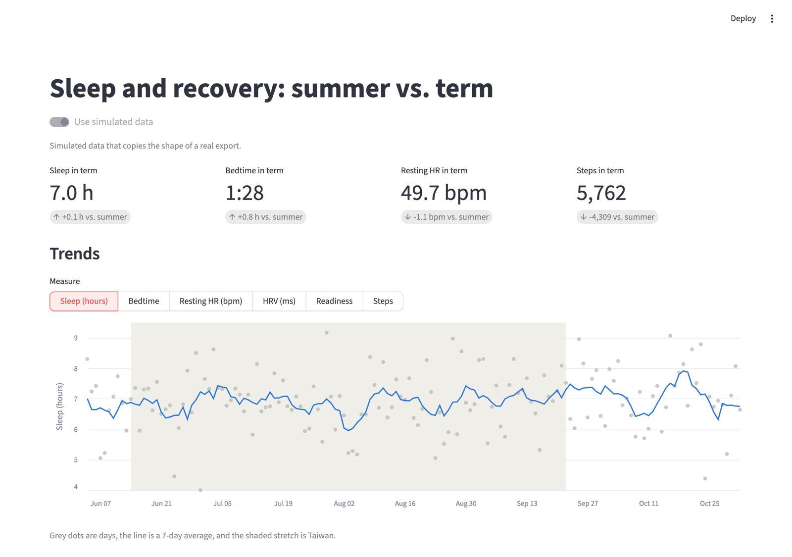

# Sleep and Recovery

<p align="center">
  
  <br><em>The dashboard, running on simulated data.</em>
</p>

## What this demonstrates

- **Merging overlapping time intervals in SQL.** Duplicate sleep records are grouped with gaps-and-islands window functions in DuckDB ([`sql/01_staging.sql`](sql/01_staging.sql#L34-L62)), explained in [one problem in depth](#one-problem-in-depth-every-night-recorded-twice).
- **Test-driven data cleaning.** Each problem found in the export is reproduced in a small fake export ([`tests/conftest.py`](tests/conftest.py)) and has a test that fails without the fix ([`tests/test_build.py`](tests/test_build.py)).
- **Walk-forward modeling without leakage.** Each day's HRV prediction comes from a model trained only on earlier days ([`recovery/model.py`](recovery/model.py#L73-L83)). A test changes every later target by 1000 and checks that no earlier prediction moves ([`tests/test_model.py`](tests/test_model.py#L37-L43)).
- **Honest uncertainty for correlated days.** Group comparisons use a block bootstrap, because neighboring days are alike ([`recovery/analysis.py`](recovery/analysis.py#L53-L79)). A test shows it gives wider, more honest intervals than treating days as independent ([`tests/test_analysis.py`](tests/test_analysis.py#L38-L46)).
- **Keeping private data out of a public repo.** Everything shown here runs on a simulated export with the same quirks, and a test fails if the notebook is ever committed with outputs.

A data pipeline and analysis built on my own Google Health export: about eight months of sleep, heart rate, HRV, and activity from two wearables, across two countries. Most of the work is turning a messy export into a table that can be trusted. That meant finding duplicate records, mixed time zones, a device change partway through, overlapping step counters, and partial days, then fixing each one with code and a test.

On top of that clean table, the analysis asks whether school changes how I sleep and recover. It compares summer with the term, an internship with free summer days, and exam days with ordinary ones, and tests whether tomorrow's HRV can be predicted. Several answers turned out to be "no clear effect", which is a finding too. It's a study of one person, so the results describe me and nobody else.

## Problems found in the export

These came up while building the table, and each one would have changed the results if missed. Each fix has a test in `tests/test_build.py` that uses a small fake export with the same problem.

- **Most nights are in the export twice.** Fitbit's `sleep_session_v1` and `sleep_session_v2` both score the same night, with slightly different times. Counting both doubled sleep totals and made nearly every day look like it had a nap. Overlapping records are merged and v2 is kept, which removed about half the sleep records.
- **The time zone moves.** Timestamps are in UTC, and the data spans the US and Taiwan. Each sleep saves its own offset, so times are converted to local time with that.
- **The device changed in June 2026.** Apple Watch HRV is SDNN and Fitbit HRV is RMSSD, so their values differ a lot and can't be compared directly. Comparisons of HRV use Fitbit days only, or compare each day with a baseline from the same device.
- **The phone and the watch both count steps.** Adding them double-counts, so each day uses the single source with the most steps.
- **The first and last days are partial.** The export begins and ends partway through a day, which made those days look inactive.
- **Missing values have markers.** Sleep sub-scores use `-2` for "not calculated", and some Apple HRV rows are `0`. Both are treated as missing.
- **Some data is too sparse to use.** The stress score has 4 days, there are 21 workouts, and there's no sleep data from the Apple Watch period.

## One problem in depth: every night recorded twice

**The problem.** Fitbit scores most nights with two algorithms, `sleep_session_v1` and `sleep_session_v2`, and the export keeps both records. Their start and end times differ by a few minutes, and v1 sometimes splits a night into two pieces. The two records share no ID that links them, so the only sign they describe the same sleep is that their times overlap.

**Naive approach 1: count every record.** On the simulated export, summing all records gives 13.5 hours of sleep a day instead of 7.0. Every second record also shows up as a "nap".

**Naive approach 2: compare each record with the one before it.** Sorting by start time and starting a new sleep whenever a record begins after the previous record ended (`lag(end_utc)`) almost works. It fails when v1 splits a night:

```text
v2   00:30 ──────────────────────────────── 07:30
v1a  00:31 ────────── 04:00
v1b                         04:10 ───────────────── 07:40
```

`v1b` starts after `v1a` ends, so `lag()` calls it a new sleep, even though the v2 record still runs until 07:30.

**The fix.** Compare each record with the latest end of *every* earlier record, not just the previous one. A record starts a new sleep only when it begins after all earlier records have ended. A running sum of those starts numbers the sleeps, and `QUALIFY` keeps one record per sleep, v2 first, so every night uses the same algorithm ([`sql/01_staging.sql`](sql/01_staging.sql#L34-L62)):

```sql
WITH ordered AS (
    SELECT *, max(end_utc) OVER (
        ORDER BY start_utc, end_utc ROWS BETWEEN UNBOUNDED PRECEDING AND 1 PRECEDING
    ) AS previous_end
    FROM sleeps
),
numbered AS (
    SELECT *, sum(CASE WHEN previous_end IS NULL OR start_utc >= previous_end THEN 1 ELSE 0 END)
        OVER (ORDER BY start_utc, end_utc ROWS UNBOUNDED PRECEDING) AS episode
    FROM ordered
)
SELECT * EXCLUDE (previous_end) FROM numbered
QUALIFY row_number() OVER (
    PARTITION BY episode
    ORDER BY CASE algorithm_version WHEN 'sleep_session_v2' THEN 0 WHEN 'sleep_session_v1' THEN 1 ELSE 2 END,
             minutes_asleep DESC
) = 1;
```

**The test.** The fake export in [`tests/conftest.py`](tests/conftest.py) has exactly the night drawn above, plus a real afternoon nap. [`tests/test_build.py`](tests/test_build.py#L38-L53) checks that the night becomes one 390-minute v2 sleep, that the nap is still counted, and that the split v1 pieces don't start a second sleep. Swapping the running `max()` for `lag()` makes three tests fail. On the real export, this step removed about half the sleep records.

## Privacy

None of my health data or results are in this repository. The code runs on the real export locally, and on a simulated one everywhere else.

- The raw export stays in `~/Downloads` and is only read, never copied.
- Everything built from it goes to `data/`. The executed notebook and the written report go to `private/`. `.gitignore` excludes both folders, along with `calendar.csv`, which has personal dates.
- `explore.ipynb` is saved without outputs. `tests/test_privacy.py` fails if it ever has outputs, so real charts can't be committed by accident.
- The dashboard only listens on localhost and doesn't send Streamlit usage statistics (`.streamlit/config.toml`).

## Setup

```bash
python3 -m venv .venv
.venv/bin/pip install -r requirements.txt -e .
```

## Try it with simulated data

```bash
.venv/bin/python -m recovery.simulator data/sample
.venv/bin/python -m recovery --export "data/sample/Google Health" --db data/demo.duckdb --calendar calendar.example.csv
.venv/bin/streamlit run app.py
```

The build prints what the cleaning found. On the simulated export:

```text
Data cleaning
  Sleep records:   328 in the export, 175 after merging overlapping v1/v2 records of the same sleep
  Time zones:      3 UTC offsets, every timestamp converted to local time
  Steps:           2 overlapping sources, one chosen per day (0 days from the phone)
  Heart devices:   0 Apple Watch days and 151 Fitbit days, kept apart because they measure HRV differently
  Partial days:    2 dropped at the start and end of the export
```

`recovery/simulator.py` writes an invented export with the same files and quirks as a real one: duplicate sleep records, two step counters, and a move from the US to Taiwan and back. The dashboard simulates one by itself when there's no real database.

## Build the database from a real export

```bash
.venv/bin/python -m recovery --export "~/Downloads/health data/Google Health"
```

This creates `data/health.duckdb` and prints how many days each measurement covers. Label exams, trips, and other periods in `calendar.csv` (the format is in `calendar.example.csv`):

- `midterms` and `finals` mark exam days.
- A period whose name ends in `trip` is left out of the comparisons.
- Ranges can overlap, and the narrowest one wins, so an exam day inside a summer is labeled as the exam.

Open the result from Python:

```python
import duckdb
daily = duckdb.connect("data/health.duckdb", read_only=True).table("daily").df()
```

## The `daily` table

One row per day. The first and last days of the export are left out, because the export starts and ends partway through a day. A day's sleep is the sleep you woke up from that morning, which is also how Fitbit dates resting heart rate, HRV, and readiness.

| Column | Meaning |
|---|---|
| `location`, `utc_offset_min` | Taiwan for +08:00 and US for the US zones, from the time zone saved with each sleep |
| `period` | Label from `calendar.csv`, or empty |
| `sleep_algorithm`, `bedtime`, `wake_time` | Which Fitbit algorithm scored the main sleep, and its local times |
| `main_sleep_minutes`, `total_sleep_minutes`, `nap_count` | Longest sleep, all sleep including naps, and the number of naps |
| `sleep_score`, `deep_sleep_minutes`, `rem_sleep_percent`, `restlessness` | From Fitbit's sleep score |
| `resting_hr`, `hrv_ms`, `heart_device` | Daily resting heart rate and HRV, and which device measured them |
| `readiness_score`, `readiness_level` | Fitbit's daily readiness |
| `steps`, `steps_source` | Steps from the device that counted the most that day |
| `active_zone_minutes` | Minutes in fat burn, cardio, or peak zones |

The SQL that builds it is in `sql/`. `01_staging.sql` types and cleans each file, and `02_daily.sql` joins them by day.

## Analysis

`explore.ipynb` covers data coverage, trends, summer vs. term, internship vs. free summer days, term weekdays vs. weekends, jet lag, sleep vs. HRV, exams, and HRV prediction. Run it into `private/` so the outputs stay out of git:

```bash
.venv/bin/jupyter nbconvert --to notebook --execute explore.ipynb --output-dir private
```

Then open `private/explore.ipynb` to read it.

The methods, in `recovery/analysis.py` and `recovery/model.py`:

- **Group comparisons** use a block bootstrap that resamples runs of 7 days within each group, because neighboring days are too alike to count as independent. They leave out Apple Watch days, trips, and the first 7 days after each long flight.
- **Summer vs. term** mixes the effect of school with a change of country and time zone. Internship vs. free summer days (both in Taiwan) and weekdays vs. weekends (both in the term) compare days in the same place.
- **Exams** are each compared with their own baseline: the 7 most recent ordinary days ending 3 days before, from the same device. That keeps the device change and the seasons out of the result, so exams from both devices count. The interval resamples whole exam periods, since exams days apart share a stretch of time.
- **HRV prediction** compares two ridge regression models with "same as yesterday" and "average of the last 7 days", walk-forward, so each day's model is trained only on earlier days. The evening model uses only what's known before going to sleep, and the morning model adds the night's sleep. The tests check that changing future days doesn't change earlier predictions, and that the model finds a sleep effect planted in simulated data.

## Dashboard

```bash
.venv/bin/streamlit run app.py
```

It shows the real database when `data/health.duckdb` exists, with a switch to simulated data. It has headline numbers, trends, the comparisons, and the model results. Start it with `SIMULATED_ONLY=1` to make sure it never reads the real database, which is how the screenshot above was taken.

## Tests

```bash
.venv/bin/python -m pytest
```
